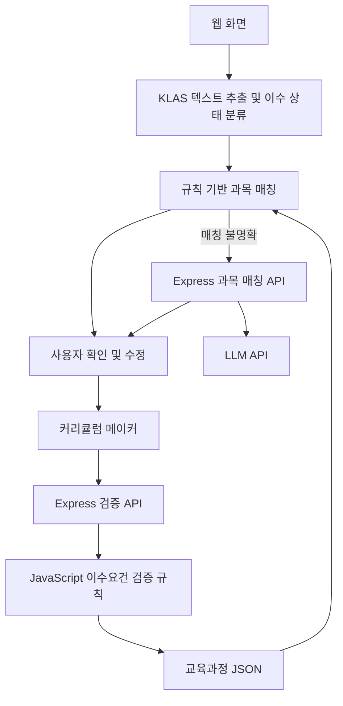

# 🌳 CurriTree

> KLAS 이수 내역을 바탕으로 나만의 전공 수강 계획을 세우고, 이수요건을 점검하는 커리큘럼 플래너

**CurriTree(커리트리)** 는 광운대학교 학생들이 자신의 이수 내역을 간편하게 입력하고, 남은 학기의 전공 수강 계획을 설계할 수 있도록 지원하는 웹 애플리케이션입니다.

KLAS에서 복사한 수강 내역을 분석하여 이수 과목을 불러오고, 교육과정 데이터와 비교해 과목을 매칭합니다. 이후 학생이 직접 확인한 이수 내역과 수강 예정 과목을 바탕으로 학점, 전공 이수요건, 선수 과목 순서 등을 점검합니다.

추가적으로 전공이수체계도를 과목 관계 그래프로 시각화하여 관심 분야의 학습 경로를 탐색할 수 있도록 합니다.

> [!IMPORTANT]
> CurriTree에서 제공하는 이수요건 판정은 **사용자가 확인한 이수 내역과 수강 계획, 서비스에 등록된 교육과정 데이터를 기준으로 한 참고 결과**입니다.
>
> 실제 졸업 가능 여부는 입학년도, 학위과정, 교양·공학인증·졸업작품 등 추가 요건에 따라 달라질 수 있습니다. 최종 확인은 학교의 공식 학사 시스템과 학과 사무실에서 진행해야 합니다.

## 1. 프로젝트 배경과 목표

광운대학교 컴퓨터정보공학부 학생들은 수강신청 기간마다 전공필수와 전공선택 과목을 확인하고, 남은 학기에 어떤 과목을 수강할지 계획해야 합니다.

현재는 학과 홈페이지의 전공이수체계도와 교과과정편성표, KLAS 성적 조회 화면, 선배의 시간표 등을 참고하고 있지만 다음과 같은 불편함이 있습니다.

- 현재까지 이수한 과목을 정리하려면 여러 학기의 수강 내역을 직접 확인해야 합니다.
- 이미 이수한 과목을 수강 계획 서비스에 입력할 때 과목을 하나씩 선택해야 하는 번거로움이 있습니다.
- 과목명이나 교육과정이 변경된 경우 동일한 과목인지 판단하기 어렵습니다.
- 선택한 과목이 어떤 심화 과목으로 이어지는지 한눈에 파악하기 어렵습니다.
- 앞으로 수강할 과목을 포함했을 때 전공필수·전공선택 학점과 이수요건을 얼마나 충족하는지 계산하기 어렵습니다.

CurriTree는 이러한 문제를 해결하기 위해 다음의 사용 흐름을 제공합니다.

1. KLAS 수강 내역 복사 및 붙여넣기
2. 이수 과목 추출 및 교육과정 과목 매칭
3. 매칭 결과 사용자 확인·수정
4. 학기별 수강 계획 작성
5. 이수요건 및 선수 과목 순서 검증
6. 전공 로드맵 탐색 및 추가 기능 활용

### ChatGPT에 직접 질문하는 방식과의 차이

1. **일관된 계산:** 학점 합산, 선수 과목 검사, 이수요건 판정을 JavaScript 함수로 수행하므로 같은 입력에는 같은 결과를 반환합니다.
2. **간편한 이수 내역 입력:** KLAS에서 복사한 수강 내역을 붙여 넣으면 과목을 자동으로 추출하고, 사용자가 결과를 확인할 수 있습니다.
3. **구조화된 데이터:** 공식 교육과정 자료를 바탕으로 과목, 학점, 이수구분, 과목 관계 및 적용 연도를 관리합니다.
4. **직관적인 수강 계획 편집:** 과목을 선택해 학기별로 배치하면 이수요건 점검 결과를 확인할 수 있습니다.
5. **제한적인 LLM 활용:** LLM은 불명확한 과목명 매칭을 지원하며, 실제 이수 여부와 졸업요건은 정해진 계산 규칙으로 판단합니다.

## 2. 주요 기능

### 2.1 KLAS 수강 내역 가져오기

사용자가 KLAS 성적 조회 화면의 수강 내역을 복사하여 입력창에 붙여 넣으면, 브라우저에서 필요한 정보를 추출합니다.

**주요 기능**

- 여러 학기의 수강 내역을 한 번에 입력
- 학년도 및 정규학기·계절학기 구분
- 학정번호, 과목명, 학점, 이수구분 추출
- 성적과 재수강 정보를 활용한 이수 상태 분류
- 이수 완료·수강 중·미이수·확인 필요 과목 구분
- 추출 결과 미리보기 및 사용자 수정
- 최종 확인된 이수 내역을 커리큘럼 메이커에 반영

KLAS에서 복사한 데이터는 표가 아닌 탭과 줄바꿈으로 구분된 일반 텍스트일 수 있으므로, 실제 복사 형식을 기준으로 파싱 규칙을 구현합니다.

F 성적, 삭제된 재수강 기록, 성적이 입력되지 않은 수강 중 과목 등은 이수 완료 과목과 구분합니다.

학점을 취득했는지 명확하게 판단할 수 없는 경우 임의로 이수 완료 처리하지 않고 `확인 필요` 상태로 표시합니다.

전공 교육과정 JSON에 포함되지 않은 교양·일반선택 과목도 별도로 관리합니다. 이수 완료 여부가 확인된 과목의 학점은 총 취득 학점 계산에 반영하되, 전공필수·전공선택 학점과 구분합니다. 이수구분이나 학점 인정 여부가 불명확한 경우에는 확인 필요로 처리합니다.

### 2.2 AI 과목 매칭 도우미

KLAS에서 추출한 과목명과 교육과정 JSON의 과목 정보를 비교하여 동일한 과목을 찾습니다.

**매칭 과정**

1. JavaScript 규칙을 이용해 정확히 일치하는 과목을 먼저 탐색합니다.
2. 과목명이 다르거나 여러 후보가 존재하는 경우 확인이 필요한 과목으로 분류합니다.
3. 불명확한 과목명과 교육과정의 매칭 후보 정보를 Express 서버로 전달합니다.
4. 서버가 LLM API를 호출하여 매칭 후보를 분석합니다.
5. LLM의 응답을 허용된 데이터 형식과 실제 과목 ID 기준으로 검증합니다.
6. 사용자가 추천된 후보를 확인·수정한 후 최종 반영합니다.

**LLM의 역할**

- 변경되거나 유사한 과목명에 대한 매칭 후보 제시
- 띄어쓰기나 표기 방식이 다른 과목명 식별 보조
- 매칭이 어려운 과목에 대한 확인 필요 결과 반환

**LLM이 수행하지 않는 작업**

- 실제 과목 이수 여부의 최종 결정
- 학점 합산 및 졸업요건 판정
- 존재하지 않는 과목이나 교육과정 정보 생성
- 사용자 확인 없는 과목 매칭 확정

LLM API 호출이 실패하거나 이용 한도에 도달한 경우에도 사용자가 과목을 직접 검색하고 선택할 수 있도록 합니다.

#### 개인정보 및 데이터 처리 원칙

KLAS에서 복사한 텍스트에는 성적이나 개인정보가 포함될 수 있으므로 다음 원칙을 적용합니다.

- KLAS 원본 텍스트는 브라우저에서만 처리합니다.
- 원본 텍스트를 서버에 전송하거나 저장하지 않습니다.
- 성적 정보는 이수 상태를 판별하는 데 필요한 범위에서만 사용합니다.
- 원문 성적, 이름, 학번 등은 LLM API에 전달하지 않습니다.
- LLM에는 과목명과 매칭에 필요한 최소한의 정보만 전달합니다.
- 원본 텍스트와 원문 성적은 브라우저 저장소에도 저장하지 않습니다.
- 매칭 결과는 사용자 확인 후에만 수강 계획에 반영합니다.

### 2.3 커리큘럼 메이커

사용자가 실제 이수 내역을 확인하고 남은 학기에 수강할 과목을 배치할 수 있는 기능입니다.

**주요 기능**

- 학과 및 적용 교육과정 선택
- 현재 학년·학기 선택
- KLAS에서 가져온 이수 내역 확인·수정
- 이수 완료 / 수강 중 / 수강 예정 / 미이수 상태 구분
- 학기별 과목 추가·제거·이동
- 과목 검색 및 선택
- 현재 취득 학점과 향후 취득 예정 학점 분리 표시
- 계획 변경 시 이수요건 점검 결과 갱신

사용자가 확인하지 않은 과거 권장 과목을 자동으로 이수 완료 처리하지 않습니다.

KLAS 입력 기능을 사용할 수 없는 경우에는 과목을 수동으로 선택하여 이수 내역과 수강 계획을 작성할 수 있도록 합니다.

### 2.4 이수요건 검증

사용자가 확정한 이수 내역과 수강 예정 과목을 바탕으로 정해진 규칙에 따라 이수요건을 점검합니다.

**검증 항목**

- 총 취득 학점 및 계획상 취득 예정 학점
- 전공필수 과목 이수 여부
- 전공선택 최소 학점
- 필수 선수 과목 이수 순서
- 권장 이수 흐름 이탈 여부
- 학기별 학점 상한 초과 여부
- 중복 과목 및 재수강 처리
- 데이터 부족으로 확인할 수 없는 요건

각 항목의 상태는 다음과 같이 구분합니다.

- **충족:** 입력된 데이터와 규칙을 기준으로 해당 요건을 만족함
- **미충족:** 필요한 과목이나 학점이 부족하거나 규칙을 위반함
- **확인 필요:** 적용 기준이나 이수 정보가 부족하여 판단할 수 없음

현재 취득한 학점과 향후 수강 계획을 모두 이행했을 때의 예상 학점은 구분하여 표시합니다.

모든 결과는 실제 졸업 확정이 아닌 **계획상 이수요건 점검 결과**로 제공합니다.

### 2.5 전공 이수 로드맵

학과에서 제공하는 전공이수체계도를 과목 관계 그래프로 시각화합니다.

**주요 기능**

- Cytoscape.js 기반 과목 관계 그래프
- 과목별 권장 학년·학기 표시
- 선택한 과목의 선행·후속 관계 탐색
- 필수 선수 조건과 권장 학습 흐름 구분
- 관심 분야에 따른 과목 필터링

AI·보안·백엔드 등의 진로 태그는 드롭다운을 이용해 선택하며, LLM 기반 자연어 진로 조건 추출 기능은 구현하지 않습니다.

전공 로드맵은 핵심 수강 계획 및 검증 기능이 안정화된 후 연결합니다.

### 2.6 수강 계획 저장 및 공유 (추가 기능)

핵심 기능 구현 이후 개발 여건에 따라 다음 기능을 검토합니다.

- 수강 계획 JSON 저장
- 무작위 조회 코드를 통한 공유 링크 발급
- 저장된 계획의 읽기 전용 조회
- 기존 계획 복제 및 수정
- 여러 수강 계획 비교

회원가입과 로그인 없이 사용할 수 있도록 설계하며, 개인정보를 수집하지 않는 범위에서 구현합니다.

## 3. 개발 범위와 우선순위

| 단계 | 우선순위 | 구현 항목 | 목표 |
| --- | --- | --- | --- |
| 핵심 MVP | P0 | 교육과정 JSON 및 조회 API, KLAS 텍스트 파싱, 과목 매칭, LLM API 호출, 사용자 확인, 학기별 수강 계획, 이수요건 검증 | 사용자가 이수 내역을 입력하고 계획을 검증하는 핵심 흐름 완성 |
| 필수 검증·배포 | P0 | 팀원별 계산 규칙 및 단위 테스트, Express API 테스트, Docker 컨테이너 실행, 공개 배포 | 수업 필수 조건 충족 및 실제 서비스 실행 |
| 주요 확장 | P1 | 전공 과목 관계 그래프, 선행·후속 과목 탐색, 진로 태그 필터, 화면 사용성 개선 | 전공 학습 경로 탐색 기능 확장 |
| 추가 기능 | P2 | 수강 계획 저장·공유, 여러 계획 비교, 자동 학기 배치 등 | 핵심 기능 완료 후 일정에 따라 검토 |

### MVP 핵심 사용 흐름

1. 사용자가 학과와 적용 교육과정을 선택합니다.
2. KLAS 수강 내역을 복사하여 입력창에 붙여 넣습니다.
3. 브라우저에서 필요한 수강 정보와 이수 상태를 추출합니다.
4. 교육과정 데이터와 과목을 매칭하고, 불명확한 과목은 LLM의 도움을 받습니다.
5. 사용자가 매칭 결과를 확인하고 수정합니다.
6. 확정된 이수 내역을 커리큘럼 메이커에 반영합니다.
7. 사용자가 남은 학기에 수강 예정 과목을 배치합니다.
8. 서버에서 이수요건을 검증하고 항목별 결과를 반환합니다.
9. 사용자가 부족한 요건을 확인하고 수강 계획을 수정합니다.

### 1차 버전의 제한 사항

- 광운대학교 컴퓨터정보공학부 한 학과를 우선 지원합니다.
- 공식 자료로 확인된 교육과정 기준 한 개를 우선 적용하며 기준 연도와 출처를 표시합니다.
- 입학년도 및 학위과정에 따라 달라지는 모든 졸업요건을 완전히 자동화하지 않습니다.
- 실제 분반, 시간표 충돌, 수강 정원 및 향후 개설 여부는 검사하지 않습니다.
- 데이터가 부족한 요건은 충족으로 간주하지 않고 `확인 필요`로 표시합니다.
- LLM의 과목 매칭 결과는 사용자가 확인해야 하며 자동 확정하지 않습니다.
- 학점과 이수요건은 실제로 이수한 과목과 수강 예정 과목을 구분하여 계산합니다.
- 실제 졸업 가능 여부는 학교의 공식 학사 시스템 및 학과 사무실을 통해 최종 확인해야 합니다.


## 4. 기술 스택

| 구분 | 기술 | 용도 |
| --- | --- | --- |
| Frontend | HTML, CSS, JavaScript (Vanilla JS) | 페이지, 학기별 계획 편집, 상태 표시 |
| Graph | Cytoscape.js | 과목 관계 그래프 시각화 |
| Backend | Node.js, Express | 교육과정 조회, 이수요건 검증, LLM 과목 매칭 API |
| Data | JSON | 교육과정·졸업요건 및 계획 데이터 관리 |
| Logic | JavaScript ES Modules | 탐색·검사·학점 계산·배치 규칙 |
| Test | JavaScript 단위 테스트 및 API 테스트 | 경계값·오류·정상 시나리오 검증 |
| Deployment | Docker | 서버 배포 및 실행 환경 통일 |
| Collaboration | Git, GitHub Issues, Pull Requests | 버전 관리와 코드 리뷰 |


## 5. 시스템 구조와 API (예정)

CurriTree는 HTML/CSS/JavaScript 기반 프론트엔드와 Express 서버로 구성합니다.

KLAS 수강 내역의 원본 텍스트는 브라우저에서 처리하며, 서버는 교육과정 데이터 제공, 이수요건 검증, LLM 과목 매칭 등을 담당합니다.

### 5.1 전체 시스템 구조



KLAS 원본 텍스트와 성적 원문은 서버나 LLM API로 전송하지 않습니다.

### 5.2 주요 API

| 메서드 | 경로 | 기능 | 우선순위 |
| --- | --- | --- | --- |
| `GET` | `/api/health` | 서버 실행 상태 확인 | P0 |
| `GET` | `/api/departments` | 지원 학과 목록 조회 | P0 |
| `GET` | `/api/curriculum/:dept` | 과목·학점·관계·이수요건 데이터 조회 | P0 |
| `POST` | `/api/ai/match-courses` | 불명확한 과목명을 LLM으로 분석하고 매칭 후보 반환 | P0 |
| `POST` | `/api/validate` | 이수 내역 및 수강 계획 검증 | P0 |
| `POST` | `/api/plans` | 수강 계획 저장 및 조회 코드 발급 | P2 |
| `GET` | `/api/plans/:code` | 저장된 수강 계획 읽기 전용 조회 | P2 |

각 API의 상세 요청·응답 형식은 기능 구현 전에 팀원들이 협의하여 `docs/`에 문서화합니다.

### 5.3 KLAS 텍스트 처리

KLAS 수강 내역은 브라우저에서 다음 순서로 처리합니다.

1. 입력된 텍스트를 학기별·과목별로 분리합니다.
2. 학정번호, 과목명, 학점, 이수구분 등을 추출합니다.
3. 성적 및 재수강 정보를 활용하여 이수 상태를 분류합니다.
4. 교육과정 JSON과 비교하여 정확히 일치하는 과목을 찾습니다.
5. 매칭이 불명확한 과목만 LLM 매칭 대상으로 분류합니다.
6. 사용자가 결과를 확인한 뒤 커리큘럼 메이커에 반영합니다.

**이수 상태 구분**

- `completed`: 이수 완료
- `in-progress`: 현재 수강 중
- `failed`: 미이수
- `needs-review`: 추가 확인 필요

재수강 및 성적 삭제 기록은 중복 학점 계산을 방지할 수 있도록 별도로 검사합니다.

확정된 과목은 교육과정의 고유 과목 ID를 기준으로 관리하며, 원문 성적은 저장하지 않습니다.

### 5.4 LLM 과목 매칭

`POST /api/ai/match-courses`는 규칙만으로 매칭하기 어려운 과목을 처리하기 위한 API입니다.

**입력**

- 교육과정 식별 정보
- 매칭이 필요한 과목명
- 매칭 후보로 사용할 교육과정 과목 정보

**처리**

1. 서버가 요청 데이터 형식을 검사합니다.
2. 허용된 교육과정 데이터를 기준으로 매칭 후보를 구성합니다.
3. LLM API에 개인정보가 제거된 과목명과 후보 정보를 전달합니다.
4. LLM이 반환한 JSON을 검증합니다.
5. 반환된 과목 ID가 실제 교육과정에 존재하는지 확인합니다.
6. 유효한 후보만 프론트엔드에 반환합니다.

LLM의 응답을 그대로 확정하지 않으며, 최종 선택은 사용자가 수행합니다.

LLM 호출이 실패하거나 응답 형식이 잘못된 경우 수동 과목 검색·선택 기능으로 대체합니다.

### 5.5 이수요건 검증

`POST /api/validate`는 사용자가 확인한 이수 내역과 학기별 수강 계획을 입력받아 검증합니다.

검증에는 화면 코드와 분리된 JavaScript 순수 함수를 사용합니다.

- 현재 취득 학점 계산
- 계획상 취득 예정 학점 계산
- 전공필수 과목 누락 검사
- 전공선택 최소 학점 검사
- 필수 선수 과목 순서 검사
- 학기별 학점 상한 검사
- 중복 과목 및 재수강 처리
- 확인 불가능한 요건 구분

결과는 항목별 `충족`, `미충족`, `확인 필요` 상태와 부족 학점 등을 포함합니다.

서버는 학점 계산과 이수요건 판정에 LLM을 사용하지 않습니다.

### 5.6 데이터 관리 및 개인정보 보호

**교육과정 데이터**

- 학과의 공식 전공이수체계도와 교과과정편성표를 기준으로 JSON을 작성합니다.
- 교육과정 기준 연도와 자료 출처를 기록합니다.
- 과목 ID, 학점, 이수구분, 권장 학기 및 과목 관계를 관리합니다.
- 존재하지 않는 과목 참조, 중복 ID, 잘못된 관계 등을 검사합니다.
- 필수 선수 조건과 권장 이수 흐름을 구분합니다.

**KLAS 데이터 및 개인정보**

- KLAS 원본 텍스트는 브라우저에서만 처리합니다.
- 원본 텍스트를 서버에 전송하거나 저장하지 않습니다.
- 성적 원문, 이름, 학번 등은 LLM에 전달하지 않습니다.
- 성적 정보는 이수 상태 판별에 필요한 범위에서만 사용합니다.
- 브라우저 저장소 및 서버 로그에 KLAS 원문을 남기지 않습니다.
- 사용자 확인 없이 LLM 매칭 결과를 확정하지 않습니다.

**서버 및 API 관리**

- LLM API 키는 서버 환경변수로 관리합니다.
- API 키와 `.env` 파일은 Git 저장소에 커밋하지 않습니다.
- API 요청 값 및 LLM 응답을 검증합니다.
- 외부 API 오류 시에도 수동 입력과 이수요건 검증 기능이 동작하도록 합니다.

### 참고 자료

- [광운대학교 컴퓨터정보공학부 홈페이지](https://ce.kw.ac.kr/)
- [컴퓨터정보공학부 졸업요건 안내](https://ce.kw.ac.kr/program/requirement.php)
- [광운대학교 공식 홈페이지](https://www.kw.ac.kr/)

## 6. 프로젝트 디렉터리 구조 (예정)

```text
CurriTree/
├── public/                 # HTML, CSS, 브라우저 JavaScript
├── server/                 # Express 앱, API 라우트, 저장 서비스, LLM 연동
├── shared/                 # 그래프 탐색, 선수 관계, 학점, 졸업요건 검증 함수
├── data/                   # 출처·버전이 명시된 교육과정 JSON
├── tests/                  # 단위 및 API 테스트
├── docs/                   # 기획서, API 명세, 데이터 스키마, 개발 문서
├── .github/                # Issue/PR 템플릿 및 CI 설정
├── .env.example            # 환경변수 이름 예시 (비밀값 없음)
├── .gitignore
├── package.json
└── README.md
```

> 위 구조는 초기 개발을 위한 합의안입니다. 실제 코드 구현에 따라 세부 파일은 달라질 수 있습니다. 사용자 계획 저장 파일과 `.env`는 저장소에 올리지 않습니다.


## 7. 팀원 및 역할 분담

CurriTree는 세 명의 팀원이 각각 주요 기능의 기획·디자인·프론트엔드·백엔드·계산 규칙·테스트에 참여하는 방식으로 개발합니다.

각 기능의 1차 책임자를 정하되, 데이터 구조와 API 명세 등 공통으로 사용하는 요소는 팀원 간 협의를 통해 확정합니다.

| 구분 | 팀원 | 주요 책임 |
| --- | --- | --- |
| **팀원 A** | `@dlxogml123` / `이태희` | 공통 디자인·초기 UI, 교육과정 데이터, 전공 로드맵 |
| **팀원 B** | `@ericcho-dev` / `조찬희` | 커리큘럼 메이커, 학점 계산, 이수요건 검증 |
| **팀원 C** | `@central324` / `박현수` | KLAS 입력 자동화, LLM 과목 매칭, Docker·배포 |

### 7.1 팀원 A — 공통 디자인, 교육과정 데이터 및 전공 로드맵

**기획·디자인**

- CurriTree의 공통 디자인 방향 설정
- 홈페이지, 헤더, 사이드바 등 공통 레이아웃 설계
- 커리메이커 초기 UI 구성
- 공통 색상, 글꼴, 버튼 및 입력 컴포넌트 기준 정리
- 전공 이수체계도 그래프 화면 구성 설계

**프론트엔드**

- 공통 헤더 및 사이드바 구현
- 홈페이지 초기 화면 구현
- 커리메이커 초기 UI 및 예시 데이터를 활용한 기본 상호작용 구현
- Cytoscape.js 기반 과목 관계 그래프 렌더링
- 과목 클릭 시 상세 정보 및 선행·후속 관계 표시
- 진로 태그 필터 및 과목 강조 기능 구현

**백엔드·데이터·계산 규칙**

- `GET /api/departments` 구현
- `GET /api/curriculum/:dept` 구현
- 컴퓨터정보공학부 교육과정 JSON 작성
- 과목별 학점·이수구분·권장 학기·선수 관계 정리
- DFS/BFS 기반 선행·후속 과목 탐색 함수 구현
- 교육과정 JSON 무결성 검사
- 진로 태그와 선행 과목을 고려한 필터 함수 구현

**테스트·산출물**

- 공통 UI 및 내비게이션 정상 동작 확인
- 교육과정 데이터의 중복 ID·누락 참조·순환 관계 검사
- 다중 선수 관계 및 선행·후속 과목 탐색 테스트
- 교육과정 데이터 출처 및 기준 연도 문서화
- 교육과정 조회 API 및 전공 로드맵 구현

**담당 범위**

공통 디자인과 커리메이커 초기 화면은 팀원 A가 담당합니다.

다만 실제 학점 계산, 이수요건 검증, KLAS 데이터 처리 로직은 포함하지 않으며 해당 기능의 담당자와 협의하여 연결합니다.

### 7.2 팀원 B — 커리큘럼 메이커 및 이수요건 검증

**기획·디자인**

- 학기별 수강 계획 편집 흐름 설계
- 이수 완료·수강 중·수강 예정 상태 표시 기준 정리
- 학점 현황과 이수요건 검증 패널 구성
- 팀원 A의 초기 UI와 실제 기능 연결 방식 협의

**프론트엔드**

- 학기별 과목 추가·제거·이동 기능 구현
- 이수 완료 및 수강 예정 과목 관리
- KLAS에서 확인한 이수 내역을 수강 계획에 반영
- 학점 및 이수요건 검증 결과 표시
- 계획 변경 시 서버 검증 결과 갱신
- 충족·미충족·확인 필요 상태 구분

**백엔드·계산 규칙**

- `POST /api/validate` 구현
- 총 취득 학점과 예정 학점 분리 계산
- 전공필수 과목 누락 검사
- 전공선택 최소 학점 검사
- 필수 선수 과목 순서 검사
- 학기별 학점 상한 검사
- 동일 과목 중복 배치 및 학점 중복 계산 방지
- 정보가 부족한 요건의 확인 필요 처리
- 검증 결과 및 부족 학점 반환

**테스트·산출물**

- 필수 과목 누락 및 최소 학점 경계값 테스트
- 선수 과목이 같은 학기 또는 뒤 학기에 배치된 경우 테스트
- 이수 완료와 수강 예정 과목 구분 테스트
- 중복 과목 및 재수강 관련 검증 테스트
- 입력 오류 및 확인 불가능한 요건 테스트
- 커리큘럼 메이커와 이수요건 검증 API 완성

### 7.3 팀원 C — KLAS 입력 자동화, LLM 과목 매칭 및 배포

**기획·디자인**

- KLAS 수강 내역 입력 화면 설계
- 텍스트 추출 및 과목 매칭 결과 미리보기 구성
- 매칭 실패·불명확한 과목의 확인 UI 설계
- 사용자 확인·수정 후 이수 내역 반영 흐름 설계
- 개인정보 보호 및 오류 발생 시 대체 입력 방식 정리

**프론트엔드**

- KLAS 텍스트 붙여넣기 입력 화면 구현
- 추출된 수강 내역의 학기별 목록 표시
- 이수 완료·수강 중·미이수·확인 필요 상태 표시
- 과목 매칭 결과 미리보기 및 수정 기능
- LLM 매칭 후보 선택·확정 인터페이스 구현
- 매칭 실패 시 수동 과목 검색·선택 기능 구현
- 확인된 이수 내역을 커리큘럼 메이커에 전달

**백엔드·계산 규칙**

- KLAS 텍스트 파싱 함수 구현
- 정규학기·계절학기 구분 규칙 구현
- 성적·재수강·삭제 기록을 고려한 이수 상태 분류
- 교육과정 JSON 기반 정확한 과목명 매칭 규칙 구현
- 불명확한 과목 및 중복 후보 분류
- `POST /api/ai/match-courses` 구현
- Express 서버에서 LLM API 실제 호출
- LLM 응답 JSON 형식 및 과목 ID 검증
- 개인정보가 포함된 원본 텍스트의 외부 전송 방지
- LLM 호출 실패 시 수동 입력 대체 처리

**개발 환경 및 배포**

- LLM API 키 및 환경변수 관리
- Docker 실행 환경 구성
- 공개 배포 환경 설정
- 통합 테스트 및 배포 문서 관리

**테스트·산출물**

- 실제 KLAS 복사 형식 기반 텍스트 파싱 테스트
- 정규학기·계절학기 구분 테스트
- F·P·재수강·삭제 성적 처리 테스트
- 정확한 과목명 및 유사 과목명 매칭 테스트
- 존재하지 않는 과목 및 중복 후보 처리 테스트
- LLM 응답 형식 오류·호출 실패 테스트
- 개인정보 전송 방지 확인
- KLAS 입력 및 LLM 매칭 기능 완성
- Docker 실행 및 공개 배포 확인

### 7.4 팀 전체 공통 책임

- 구현 전에 교육과정 JSON 구조와 API 요청·응답 형식을 합의합니다.
- 담당 기능과 작업 범위를 GitHub Issue에 명확히 작성합니다.
- 다른 팀원의 담당 기능을 수정하거나 공통 구조를 변경할 경우 사전에 협의합니다.
- 공통 UI 스타일과 데이터 필드명을 일관되게 유지합니다.
- 계산 규칙은 화면 코드와 분리된 JavaScript 함수로 구현합니다.
- 담당 기능의 정상·오류·경계값 테스트를 작성합니다.
- 다른 팀원의 Pull Request를 검토하고 피드백을 제공합니다.
- 통합 테스트 및 최종 발표에서 각자 담당 기능을 직접 시연합니다.
- 프로젝트 README 및 개발 문서를 지속적으로 갱신합니다.
- 수업 필수 조건인 화면, 계산 규칙, 테스트, 서버, LLM 호출, Docker·배포를 모두 구현합니다.

팀장: 박현수 (`@central324`)

- 프로젝트 일정 및 개발 우선순위 관리
- 팀원별 Issue 배정 및 작업 범위 조율
- 공통 API·데이터 계약 확정 관리
- Pull Request 리뷰 및 병합 진행 상황 관리
- 기능 통합·배포 및 최종 시연 준비


## 8. GitHub 협업 컨벤션 (Team Convention)

> **모든 팀원은 아래 규칙을 따릅니다.** 코드·문서·설정 변경 모두 Pull Request를 거쳐야 하며, `main`으로 병합하려면 **작성자 외 팀원 1명 이상 승인(Approve)** 이 필요합니다.

### 8.1 브랜치 전략

| 종류 | 용도 | 예시 |
| --- | --- | --- |
| `main` | 항상 통합 가능한 기본 브랜치 | `main` |
| `feat/*` | 신규 기능 | `feat/curriculum-graph` |
| `fix/*` | 오류 수정 | `fix/credit-calculation` |
| `docs/*` | README·개발 문서 수정 | `docs/api-spec` |
| `test/*` | 테스트 추가·수정 | `test/prerequisite-rules` |
| `refactor/*` | 기능 변경 없는 구조 개선 | `refactor/shared-validator` |
| `chore/*` | 개발 환경·설정 관리 | `chore/express-setup` |

- 기능이나 이슈 단위로 브랜치를 생성합니다. 팀원별 장기 브랜치는 사용하지 않습니다.
- 브랜치명은 영어 소문자와 하이픈(`-`)을 기본으로 합니다.
- `main`에 직접 push하지 않습니다.
- 완료된 브랜치는 PR 병합 후 삭제합니다.

### 8.2 Git 작업 순서

1. **Issue 등록:** 작업의 목적, 완료 기준, 담당자를 정합니다.
2. **최신 `main` 받기:** 작업 시작 전 로컬 기본 브랜치를 업데이트합니다.
3. **기능 브랜치 생성:** `feat/기능명` 등 정해진 규칙으로 생성합니다.
4. **구현 및 테스트:** 작은 단위로 커밋하고, 테스트 결과를 확인합니다.
5. **원격 브랜치 push:** 작업 브랜치를 GitHub에 업로드합니다.
6. **PR 생성:** 변경 사항, 관련 Issue, 테스트 방법, 화면 캡처를 첨부합니다.
7. **팀원 리뷰:** 최소 1명의 승인과 필요한 수정 반영 후 병합합니다.
8. **병합 및 정리:** `main`에 병합 후 원격 기능 브랜치를 삭제합니다.

새 기능을 시작할 때의 명령어 예시:

```bash
git switch main
git pull origin main
git switch -c feat/curriculum-graph

# 파일 수정 후
git add .
git commit -m "feat: 전공 과목 그래프 구현"
git push -u origin feat/curriculum-graph
```

이후 GitHub에서 `main`을 대상으로 Pull Request를 생성합니다. 다른 팀원의 변경이 먼저 병합되었다면 최신 `main`을 반영하고 충돌을 해결한 후 다시 테스트합니다. **자신이 수정하지 않은 팀원의 변경을 임의로 삭제하지 않습니다.**

### 8.3 커밋 메시지 규칙

**형식:** `type: 변경 사항을 간결하게 설명`

| Type | 의미 | 예시 |
| --- | --- | --- |
| `feat` | 새로운 기능 | `feat: 학기별 과목 추가 기능 구현` |
| `fix` | 버그 수정 | `fix: 학점 중복 합산 오류 수정` |
| `docs` | 문서 수정 | `docs: 팀원 역할 및 실행 방법 추가` |
| `test` | 테스트 추가·수정 | `test: 선수 관계 경계값 테스트 추가` |
| `refactor` | 동작 유지하며 코드 개선 | `refactor: 학점 계산 함수 분리` |
| `style` | 공백·포맷 등 동작과 무관한 수정 | `style: CSS 들여쓰기 정리` |
| `chore` | 설정·환경·기타 작업 | `chore: Node 개발 환경 설정` |

- 제목만 보고 변경 의도를 이해할 수 있게 작성합니다.
- 서로 무관한 변경은 가능한 한 별도 커밋이나 PR로 분리합니다.
- `update`, `수정`, `작업완료` 등 모호한 메시지만 사용하지 않습니다.
- 코드와 함께 필요한 테스트·문서도 같은 작업 범위에서 갱신합니다.

### 8.4 Issue 작성 규칙

**제목 예시:** `[Feat] 커리큘럼 메이커 학기별 과목 이동`

Issue에는 다음을 포함합니다.

- **목적:** 왜 필요한 작업인가?
- **할 일:** 구현 또는 수정할 구체적인 항목
- **완료 기준(DoD):** 무엇을 확인하면 완료로 볼 수 있는가?
- **담당자:** 해당 작업의 1차 책임자
- **관련 자료:** API 명세, 화면 시안, 선행 Issue 등

권장 라벨: `feature`, `bug`, `documentation`, `test`, `frontend`, `backend`, `data`, `priority-high`.

### 8.5 Pull Request 작성 규칙

**제목 예시:** `[Feat] 전공 이수 로드맵 그래프 구현`

PR 본문에 다음 내용을 작성합니다.

```md
## 작업 내용
- 어떤 기능을 추가하거나 수정했는지

## 관련 Issue
- Closes #이슈번호

## 테스트
- [ ] 로컬 실행 확인
- [ ] 관련 단위 테스트 확인
- [ ] 기존 주요 기능 영향 확인

## 화면 / 참고 사항
- UI 변경 시 스크린샷 첨부
- 리뷰어가 알아야 할 제한 사항 기재
```

- PR 하나에는 가급적 하나의 독립된 기능 또는 수정 목적을 담습니다.
- 다른 팀원이 검토할 수 있는 크기로 나누며, 큰 변경은 미리 공유합니다.
- 작성자는 필요한 테스트를 먼저 수행하고 PR 결과를 사실대로 기록합니다.
- 리뷰 의견이 오면 댓글로 답변하거나 수정 커밋을 올립니다.
- **작성자 본인의 승인은 승인 인원으로 인정하지 않습니다.**

### 8.6 GitHub Ruleset — `main` 병합 보호

팀 저장소의 기본 브랜치 `main`에 아래 규칙을 적용합니다.

| 설정 | 팀 규칙 |
| --- | --- |
| Target branch | `main` |
| Require a pull request before merging | **활성화** |
| Required approvals | **최소 1명** |
| Review 주체 | PR 작성자가 아닌 다른 팀원 |
| Block force pushes | **활성화** |
| Restrict deletions | **활성화** |
| Require conversation resolution | **활성화 권장** |
| Require status checks | CI 테스트가 구성된 후 활성화 검토 |
| Merge 방식 | **Squash merge 권장** |
| Bypass 권한 | 리뷰 필수 정책이 우회되지 않도록 팀장과 팀원이 함께 확인 |


리뷰어는 다음을 확인합니다.

1. Issue의 요구 사항과 실제 구현이 일치하는가?
2. 기존 기능이나 공통 API 계약을 깨뜨리지 않는가?
3. 오류 처리와 경계값 테스트가 적절한가?
4. 임시 디버깅 코드, 비밀키, 민감한 파일이 포함되지 않았는가?
5. 수정이 필요하면 `Request changes`, 문제가 없으면 `Approve`를 선택했는가?

> **승인 1명 이상을 받기 전에는 누구도 `main`에 병합하지 않습니다.** 승인 이후 중요 코드가 변경되면 리뷰어에게 변경 사항을 다시 알려 확인을 요청합니다.

### 8.7 코드 작성·협업 원칙

- JavaScript 변수·함수명은 의미가 분명한 영어 이름으로 작성합니다.
- 과목 데이터의 식별자는 이름이 아닌 고유 `id`를 기준으로 처리합니다.
- 계산 규칙은 화면 이벤트 처리와 분리한 순수 함수로 작성합니다.
- API 필드나 데이터 스키마를 변경해야 할 때는 **관련 팀원에게 먼저 알리고 명세를 함께 수정**합니다.
- 비밀키, `.env`, 개인 정보, 대용량 로컬 생성물은 Git에 커밋하지 않습니다.
- 충돌이 발생하면 해당 파일의 담당자와 확인하고 해결합니다.
- 문제를 발견하면 재현 방법이 포함된 Issue를 등록합니다.
- 최소한 담당 기능의 정상 사례, 오류 사례, 경계값 사례를 테스트합니다.


## 9. 테스트 원칙

CurriTree의 핵심 계산 및 데이터 처리 규칙은 화면 코드와 분리된 JavaScript 함수로 작성하고 단위 테스트를 수행합니다.

특히 KLAS 텍스트 분석, 과목 매칭, 학점 계산 및 이수요건 검증은 동일한 입력에 대해 항상 동일한 결과가 나와야 합니다.

### 9.1 교육과정 데이터 및 그래프

- 필수 데이터 필드 누락 및 잘못된 형식
- 중복 과목 ID 및 존재하지 않는 과목 참조
- 선수 관계의 순환 여부 검사
- 여러 단계의 선행·후속 과목 탐색
- 다중 선수 관계 처리
- 진로 태그 필터 및 관련 선행 과목 선택

### 9.2 KLAS 텍스트 파싱

실제 KLAS 복사 형식을 참고하여 개인정보가 포함되지 않은 테스트 데이터를 작성합니다.

- 탭과 줄바꿈으로 구분된 과목 데이터 추출
- 여러 학년·학기 데이터의 연속 입력
- 정규학기 및 계절학기 구분
- 과목명·학정번호·학점·이수구분 추출
- F 성적 및 미이수 과목 처리
- P 성적 및 이수 완료 과목 처리
- 성적이 비어 있는 수강 중 과목 처리
- 재수강 및 삭제된 성적 기록 처리
- 동일 과목의 중복 이수 처리
- 과목 정보 누락 및 잘못된 입력 형식 처리

### 9.3 과목 매칭 및 LLM

- 교육과정 JSON과 정확히 일치하는 과목명
- 띄어쓰기 및 표기 방식이 다른 과목명
- 유사한 과목명이 여러 개 존재하는 경우
- 교육과정에 존재하지 않는 과목
- 매칭되지 않은 과목의 확인 필요 처리
- LLM 응답 JSON 형식 오류
- 실제 교육과정에 없는 과목 ID 반환
- LLM 호출 실패 및 사용 한도 초과
- 사용자 확인 전 매칭 결과가 확정되지 않는지 검사
- KLAS 원문 및 성적 정보가 LLM 요청에 포함되지 않는지 검사

LLM을 사용하는 기능은 응답을 대체한 자동 테스트를 작성하고, 실제 API 호출은 별도의 통합 테스트에서 확인합니다.

### 9.4 학점 및 이수요건 검증

- 이수 완료와 수강 예정 과목의 학점 구분
- 정확히 최소 학점을 충족한 경우
- 최소 학점보다 1학점 부족한 경우
- 전공필수 과목 누락
- 전공선택 학점 부족
- 동일 과목 중복 배치 및 중복 학점 계산
- 재수강에 따른 학점 중복 처리
- 선수 과목이 동일 학기 또는 뒤 학기에 배치된 경우
- 학기 학점 상한 경계값
- 데이터 부족으로 판정할 수 없는 요건
- 존재하지 않는 과목 ID 및 잘못된 학기 형식

### 9.5 API 및 통합 테스트

- 교육과정 조회 API 정상·오류 응답
- 과목 매칭 API 입력값 검증
- 이수요건 검증 API 정상·오류 응답
- 브라우저에서 확인한 이수 내역의 커리메이커 반영
- 계획 수정 후 검증 결과 갱신
- LLM 호출 실패 시 수동 입력 기능 정상 동작
- 개인정보가 서버 요청·로그에 포함되지 않는지 확인
- Docker 컨테이너 실행 및 API 접근
- 공개 배포 환경에서 핵심 기능 동작 확인

### 테스트 작성 원칙

- 계산 규칙은 화면 없이 독립적으로 실행할 수 있어야 합니다.
- 정상 사례, 오류 사례, 경계값 사례를 포함합니다.
- 수업 요구사항에 따라 계산 규칙에 대한 단위 테스트를 최소 5개 이상 작성합니다.
- 각 팀원은 자신이 담당한 기능의 테스트를 직접 작성하고 결과를 확인합니다.
- 실제 학생의 성적이나 개인정보가 포함된 데이터를 테스트 파일에 저장하지 않습니다.
- Pull Request에는 실행한 테스트와 확인 결과를 기록합니다.

**완료 정의(Definition of Done)**

담당 기능이 정상적으로 동작하고, 관련 단위 테스트 및 필요한 API 테스트가 통과하며, 문서가 갱신되고, 다른 팀원 1명 이상에게 PR 승인을 받아 `main`에 병합된 상태를 의미합니다.


## 10. 로컬 실행 방법

CurriTree는 Node.js와 Express를 이용해 프론트엔드 및 API 서버를 실행합니다.

### 10.1 개발 환경

- Node.js 22 이상
- npm
- Git
- Visual Studio Code 권장

### 10.2 프로젝트 설치 및 실행

저장소를 클론합니다.

```bash
git clone https://github.com/central324/CurriTree.git
cd CurriTree
```

의존성을 설치합니다.

```bash
npm ci
```

개발 서버를 실행합니다.

```bash
npm run dev
```

실행 후 다음 주소에서 확인할 수 있습니다.

- 웹 화면: http://localhost:3000
- 서버 상태 확인: http://localhost:3000/api/health

### 10.3 테스트 실행

```bash
npm test
```

관련 테스트는 기능 구현에 따라 `tests/` 디렉터리에 추가합니다.

### 10.4 일반 서버 실행

```bash
npm start
```

### 10.5 환경변수

LLM API 키 등 필요한 환경변수는 `.env.example`을 참고하여 설정합니다.

실제 API 키가 포함된 `.env` 파일은 Git 저장소에 커밋하지 않습니다.

LLM 기능은 실제 API 호출이 필요한 기능으로 구현하며, 호출 실패 시에도 수동 과목 입력과 이수요건 검증은 계속 사용할 수 있도록 합니다.

### 10.6 Docker 및 배포

Docker 실행과 공개 배포는 수업 필수 요구사항입니다.

Docker 관련 설정 및 실행 명령어는 배포 환경이 구성된 이후 이 문서에 추가합니다.

실제 배포는 Express 서버와 프론트엔드가 함께 동작하는 형태로 진행하며, 무료 배포 환경의 메모리 제한을 고려합니다.

> 현재 저장소에는 초기 Express 서버와 기본 화면 및 테스트 환경이 구성되어 있습니다. 교육과정 조회, KLAS 입력, LLM 매칭, 이수요건 검증 등 주요 기능은 순차적으로 개발할 예정입니다.


## 11. 개발 진행 현황

### 11.1 프로젝트 기획 및 협업 환경

- [x] GitHub 팀 저장소 생성
- [x] 프로젝트 주제 기획 및 제출
- [x] 교수님 프로젝트 주제 승인
- [x] 교수님 피드백 검토 및 기획 변경 Issue 등록
- [x] GitHub 협업 규칙 및 PR 템플릿 작성
- [x] `main` 브랜치 최소 1명 승인 Ruleset 설정
- [x] 초기 Express 서버 및 기본 개발 환경 구성
- [ ] 교수님 피드백을 반영한 README 수정 PR 병합
- [ ] 변경된 프로젝트 방향 및 팀원별 역할 최종 합의
- [ ] 공통 교육과정 JSON 스키마 및 API 명세 확정

### 11.2 P0 — 핵심 MVP

**교육과정 데이터**

- [ ] 컴퓨터정보공학부 교육과정 JSON 작성
- [ ] 교육과정 데이터 검증 규칙 및 테스트 작성
- [ ] 학과 및 교육과정 조회 API 구현

**KLAS 입력 및 LLM 매칭**

- [ ] KLAS 수강 내역 입력 화면 구현
- [ ] KLAS 텍스트 파싱 규칙 구현
- [ ] 이수 완료·수강 중·미이수 상태 분류
- [ ] 교육과정 과목명 규칙 기반 매칭
- [ ] Express 서버의 LLM 과목 매칭 API 구현
- [ ] LLM 매칭 후보 확인 및 수정 UI 구현
- [ ] 개인정보 보호 및 LLM 실패 시 수동 입력 처리

**커리큘럼 메이커**

- [ ] 공통 디자인 및 초기 화면 구성
- [ ] 학기별 수강 계획 편집 기능
- [ ] KLAS에서 확인한 이수 내역 반영
- [ ] 현재 취득 학점과 수강 예정 학점 구분
- [ ] 학점 및 전공 이수요건 검증 규칙 구현
- [ ] 선수 과목 순서 및 학기 학점 상한 검사
- [ ] 이수요건 검증 API 구현
- [ ] 항목별 충족·미충족·확인 필요 결과 표시

**테스트 및 배포**

- [ ] 팀원별 계산 규칙 단위 테스트 작성
- [ ] KLAS 파싱 및 LLM 응답 검증 테스트
- [ ] API 및 핵심 기능 통합 테스트
- [ ] Docker 컨테이너 실행 환경 구성
- [ ] 공개 URL 배포 및 실제 동작 확인

### 11.3 P1 — 주요 확장 기능

- [ ] Cytoscape.js 전공 이수체계도 그래프 구현
- [ ] 선행·후속 과목 탐색 및 강조 기능
- [ ] 진로 태그 필터 구현
- [ ] 화면 사용성 및 디자인 개선

### 11.4 P2 — 추가 기능

- [ ] 수강 계획 저장·공유
- [ ] 저장된 계획 읽기 전용 조회
- [ ] 여러 수강 계획 비교
- [ ] 규칙 기반 자동 학기 배치
- [ ] 기타 편의 기능

---

**CurriTree — 나만의 전공 이수 경로를 만들어 가는 과정.**
