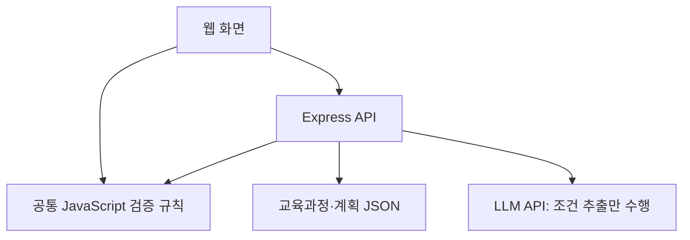

# 🌳 CurriTree

> 전공 과목의 연결 관계를 한눈에 보고, 나만의 학기별 이수 경로를 설계하는 커리큘럼 플래너

**CurriTree(커리트리)** 는 학과별 전공이수체계도를 과목 관계 그래프로 시각화하고, 학생이 구성한 수강 계획을 정해진 규칙에 따라 점검하는 웹 애플리케이션입니다.

> [!IMPORTANT]
> CurriTree의 판정은 **사용자가 입력한 이수 내역과 수강 계획, 서비스에 등록된 교육과정 데이터에 근거한 참고 결과**입니다. 실제 수강 가능 여부와 졸업 가능 여부는 학번, 학위과정, 교양·공학인증·졸업작품 등 추가 요건에 따라 달라질 수 있습니다. 최종 확인은 학교의 공식 학사 시스템과 학과 사무실에서 진행해야 합니다.

## 1. 프로젝트 배경과 목표

전공선택 과목을 결정할 때 학생들은 학과 홈페이지의 전공이수체계도 PDF, 교과과정편성표, 선배의 시간표와 커뮤니티 게시글을 참고합니다. 하지만 기존 자료만으로는 다음을 확인하기 어렵습니다.

- 관심 과목에 도달하기 위해 어떤 과목을 먼저 공부해야 하는가?
- 선택한 과목들을 어느 학기에 배치하는 것이 합리적인가?
- 이미 이수한 과목과 앞으로 수강할 과목을 합치면 전공 이수요건을 얼마나 충족하는가?
- AI·보안·백엔드 등 관심 분야별로 수강 계획을 어떻게 비교할 수 있는가?

CurriTree는 이를 해결하기 위해 **과목 관계 탐색 → 학기별 계획 작성 → 규칙 기반 검증 → 계획 저장·공유**로 이어지는 경험을 제공합니다.

### ChatGPT에 직접 질문하는 방식과의 차이

1. **일관된 계산:** 선수 관계 검사, 학점 합산, 이수요건 점검을 JavaScript 함수로 수행합니다.
2. **직관적인 편집:** 과목을 클릭해 학기에 배치하고 변경 결과를 즉시 확인합니다.
3. **구조화된 데이터:** 학과별 과목, 학점, 이수구분, 관계, 기준 연도와 검증 규칙을 명시적으로 관리합니다.
4. **공유 가능한 결과:** 조회 링크를 통해 동일한 계획을 읽기 전용으로 확인할 수 있습니다.

## 2. 주요 기능

### 2.1 전공 이수 로드맵

- 학과 및 학년 선택 후 해당 교육과정 불러오기
- Cytoscape.js를 이용한 전공 과목 관계 그래프 표시
- 선택한 과목의 모든 선행·후속 과목 탐색
- AI·보안·백엔드 등 진로 태그별 필터링
- 공식적인 **필수 선수 조건**과 학습을 돕는 **권장 이수 흐름**을 구분하여 표시

### 2.2 커리큘럼 메이커

- 과거 학기의 **이수 완료** 과목과 미래 학기의 **수강 예정** 과목 관리
- 학년 이전의 권장 과목을 편의상 미리 표시하되, 사용자가 실제 이수 내역에 맞게 수정·확정
- 학기별 과목 추가·제거·이동
- 현재 취득 학점과 계획상 취득 예정 학점 분리 표시
- 전공 이외 학점의 별도 입력 지원(정확한 분류 검증이 어려운 항목은 확인 필요로 처리)
- 변경 시 이수요건 점검 결과 갱신

### 2.3 이수요건 검증

- 필수 선수 과목의 이수 순서 위반 검사
- 권장 이수 흐름을 벗어나는 경우 안내
- 총 학점·전공필수·전공선택 학점 계산
- 필수 과목 누락 및 전공선택 최소 학점 부족 여부 검사
- 학기별 학점 상한 초과 경고(실제 기준 확인 후 적용)
- 항목별 **충족 / 미충족 / 확인 필요** 상태 및 부족 학점 표시
- 전체 결과는 실제 졸업 확정이 아닌 **입력한 계획 기준 이수요건 충족 여부**로 표시

### 2.4 계획 저장 및 공유

- 서버에 수강 계획을 JSON 형식으로 저장
- 추측하기 어려운 무작위 조회 코드 발급
- 링크를 통한 읽기 전용 조회
- 편집이 필요하면 기존 계획을 복제하여 새 계획으로 저장
- 이름·학번 등 직접적인 개인정보는 수집하지 않음

### 2.5 AI 설계 도우미

- 사용자의 자연어 문장에서 졸업 희망 시기, 진로 태그, 선호·회피 조건 등을 추출
- LLM 응답을 서버가 허용된 JSON 형식과 값으로 검증
- **과목 선택·학기 배치·최종 판정은 LLM이 아닌 규칙 기반 함수**가 담당
- 추출 조건과 생성 결과를 사용자가 직접 확인·수정
- LLM API 실패 시에도 드롭다운으로 조건을 입력해 기본 기능을 계속 사용
- 과목별 추천 이유 한 줄 생성은 추가 검토 기능

## 3. 개발 범위와 우선순위

| 단계 | 우선순위 | 구현 항목 | 목표 |
| --- | --- | --- | --- |
| **MVP** | P0 | 교육과정 JSON 및 조회 API, 과목 그래프, 학기별 배치, 학점·선수 관계 검사, 이수요건 판정 | 반드시 완성할 핵심 흐름 |
| **1차 확장** | P1 | 계획 저장·조회, 진로 태그 필터, 사용성 개선 | 사용자 경험 완성 |
| **2차 확장** | P2 | 자동 학기 배치, LLM 조건 추출, Docker 배포 고도화 | 핵심 기능 안정화 후 진행 |
| **추가 검토** | P3 | 과목별 AI 추천 이유, 다중 교육과정·학과 지원 | 일정에 여유가 있을 때 검토 |

### 1차 버전의 제한 사항

- 컴퓨터정보공학부 **한 학과, 검증된 교육과정 기준 한 개**를 우선 지원합니다.
- 실제 개설 분반, 시간표 충돌, 정원, 미래 학기의 개설 확정 여부는 검사하지 않습니다.
- 입학년도·공학/일반프로그램·세부전공에 따라 달라지는 모든 학사요건을 1차에서 완전 자동화하지 않습니다.
- 데이터가 없거나 입력되지 않은 요건은 임의로 충족 처리하지 않고 **'확인 필요'** 로 표시합니다.
- 수강 계획에 배치한 과목은 **이수 예정**이지, 이미 취득한 학점이 아닙니다.

## 4. 기술 스택

| 구분 | 기술 | 용도 |
| --- | --- | --- |
| Frontend | HTML, CSS, JavaScript (Vanilla JS) | 페이지, 학기별 계획 편집, 상태 표시 |
| Graph | Cytoscape.js | 과목 관계 그래프 시각화 |
| Backend | Node.js, Express | 교육과정 조회, 검증, 계획 저장·조회, LLM 연동 |
| Data | JSON | 교육과정·졸업요건 및 계획 데이터 관리 |
| Logic | JavaScript ES Modules | 탐색·검사·학점 계산·배치 규칙 |
| Test | JavaScript 단위 테스트 및 API 테스트 | 경계값·오류·정상 시나리오 검증 |
| Deployment | Docker | 서버 배포 및 실행 환경 통일 |
| Collaboration | Git, GitHub Issues, Pull Requests | 버전 관리와 코드 리뷰 |

## 5. 시스템 구조와 API (예정)



| 메서드 | 경로 | 기능 |
| --- | --- | --- |
| `GET` | `/api/departments` | 지원 학과 목록 조회 |
| `GET` | `/api/curriculum/:dept` | 학과의 과목·관계·이수요건 조회 |
| `POST` | `/api/validate` | 과거 이수 내역과 학기별 계획의 규칙 기반 판정 |
| `POST` | `/api/plans` | 계획 저장 및 조회 코드 발급 |
| `GET` | `/api/plans/:code` | 읽기 전용 계획 조회 |
| `POST` | `/api/ai/plan` | 자연어 조건 구조화 및 검증된 자동 계획 생성 |

> API의 상세 요청·응답 필드, 교육과정 버전 식별 방식, 오류 코드 등은 **기능별 구현 전에 팀원 전원이 합의하여 `docs/`에 확정**합니다.

### 데이터 관리 원칙

- 학과 공식 전공이수체계도·교과과정편성표를 확인하고 팀이 JSON으로 구조화합니다.
- 각 데이터에 교육과정 기준 연도와 출처를 기록합니다.
- 과목 ID의 중복, 누락된 필수 필드, 존재하지 않는 선수 과목 참조, 순환 관계를 검증합니다.
- 권장 관계와 수강 제한을 혼동하지 않습니다.
- 서버 API 키는 환경변수로 보관하고 Git에 커밋하지 않습니다.
- 사용자 저장 데이터는 제한된 필드만 허용하고 조회 코드는 임의로 추측하기 어렵게 생성합니다.

**참고 자료**

- [광운대학교 컴퓨터정보공학부 홈페이지](https://ce.kw.ac.kr/)
- [컴퓨터정보공학부 졸업요건 안내](https://ce.kw.ac.kr/program/requirement.php)
- [광운대학교 공식 홈페이지](https://www.kw.ac.kr/)

## 6. 프로젝트 디렉터리 구조 (예정)

```text
CurriTree/
├── public/                 # HTML, CSS, 브라우저 JavaScript
├── server/                 # Express 앱, API 라우트, 저장 서비스, LLM 연동
├── shared/                 # 그래프 탐색, 선수 관계, 학점, 졸업요건 검증 함수
├── data/                   # 출처·버전이 명시된 교육과정 JSON
├── tests/                  # 단위 및 API 테스트
├── docs/                   # 기획서, API 명세, 데이터 스키마, 개발 문서
├── .github/                # Issue/PR 템플릿 및 CI 설정
├── .env.example            # 환경변수 이름 예시 (비밀값 없음)
├── .gitignore
├── package.json
└── README.md
```

> 위 구조는 초기 개발을 위한 합의안입니다. 실제 코드 구현에 따라 세부 파일은 달라질 수 있습니다. 사용자 계획 저장 파일과 `.env`는 저장소에 올리지 않습니다.

## 7. 팀원 및 역할 분담

> 아래의 **팀원 이름·GitHub ID**는 팀원 확정 후 입력합니다. 각자 기획·디자인·프론트엔드·백엔드에 함께 참여하되, 아래 기능에 대한 1차 책임자를 정합니다.

| 구분 | 팀원 | 주요 책임 |
| --- | --- | --- |
| **팀원 A** | `@dlxogml123` / `이태희` | 전공 로드맵, 교육과정 데이터 및 조회 API |
| **팀원 B** | `@ericcho-dev` / `조찬희` | 커리큘럼 메이커, 학점·선수 관계 검증 및 판정 API |
| **팀원 C** | `@central324` / `박현수` | 계획 저장·공유, 자동 학기 배치, AI 도우미, 배포 |

### 7.1 팀원 A — 전공 로드맵 및 교육과정 데이터

**기획·디자인**
- 학과·학년 선택 흐름과 전공 로드맵 화면 구성 설계
- 과목 노드, 연결선, 선택 상태, 진로 태그 필터의 UI 기준 정리

**프론트엔드**
- Cytoscape.js 기반 과목 관계 그래프 렌더링
- 과목 클릭 시 상세 정보·연결 과목·선행/후속 관계 표시
- 진로 태그 필터 및 선택한 과목 강조 처리

**백엔드·데이터·로직**
- `GET /api/departments`, `GET /api/curriculum/:dept` 구현
- 컴퓨터정보공학부 과목·학점·이수구분·권장 학기·관계 JSON 작성
- DFS/BFS 등을 활용한 모든 선행·후속 과목 탐색 함수 작성
- JSON 스키마 및 선수 관계 그래프 무결성 검사

**테스트·산출물**
- 분기·다중 선수 관계·순환 데이터·누락 참조 테스트
- 데이터 출처 및 기준 연도 문서화
- 전공 로드맵과 교육과정 조회 API 완성

### 7.2 팀원 B — 커리큘럼 메이커 및 이수요건 검증

**기획·디자인**
- 학기별 계획표, 과목 선택·삭제·이동 인터랙션 설계
- 항목별 학점 현황 및 판정 패널의 상태 표시 기준 정리

**프론트엔드**
- 학기별 수강 계획 편집 UI 구현
- 이수 완료 / 수강 예정 / 미이수 구분 및 과거 이수 내역 수정 기능
- 계획 변경 시 학점·선수 관계·이수요건 결과 즉시 반영

**백엔드·검증 로직**
- `POST /api/validate` 구현
- 선수 과목 순서 및 학기 학점 상한 검사 함수 작성
- 총 학점·전공필수·전공선택 학점 계산 함수 작성
- 필수 과목 누락, 부족·초과 학점, 확인 불가 항목을 구분한 판정 함수 작성
- 중복 과목과 과거 이수/미래 계획을 구분하는 입력 검증

**테스트·산출물**
- 같은 학기 선수 과목 배치, 중복 배치, 정확한 경계 학점, 1학점 부족 등 테스트
- 판정 API 요청·응답 형식 및 오류 사례 문서화
- 커리큘럼 메이커와 이수요건 패널 완성

### 7.3 팀원 C — 계획 저장·공유, AI 도우미 및 배포

**기획·디자인**
- 계획 저장 완료, 공유 링크 확인, 읽기 전용 조회·복제 화면 설계
- 자연어 요청 입력, 추출 조건 확인·수정, 자동 생성 결과의 UI 설계

**프론트엔드**
- 계획 저장·불러오기·공유·복제 인터페이스 구현
- AI가 추출한 조건을 사용자가 확인·수정하는 입력 화면 구현
- 생성된 계획을 커리큘럼 메이커로 가져오는 연동 기능

**백엔드·로직**
- `POST /api/plans`, `GET /api/plans/:code` 구현
- 무작위 조회 코드 발급, 계획 입력값 검증, 읽기 전용 접근 처리
- 자동 학기 배치 함수 작성(선수 관계·학기 학점 상한·가용 학기 고려)
- `POST /api/ai/plan` 및 LLM 응답 스키마 검증 구현
- LLM 실패 시 수동 조건 입력으로 진행 가능한 대체 흐름 구성
- Express 초기 환경, 환경변수 예시, Docker 실행 환경 구성

**테스트·산출물**
- 잘못된 조회 코드, 중복·비정상 저장 요청, 읽기 전용 동작 테스트
- LLM 실패·형식 오류, 배치 불가능한 조건 테스트
- 저장/공유 기능, 확장 기능, 실행 및 배포 문서 완성

### 7.4 팀 전체 공통 책임

- 데이터 필드명과 API 요청·응답 계약을 코딩 전에 공동 확정
- 화면 디자인 톤, 컴포넌트 명칭, 오류 메시지 등 공통 UI 규칙 준수
- 담당 기능의 단위 테스트 및 문서화
- 다른 팀원의 PR 리뷰와 오류 재현·검증
- 통합 테스트, 시연 준비, 최종 README 및 제출물 점검
- **팀장:** `[박현수 / @central324]` — 진행 일정, Issue 배정, API·데이터 계약 확정, PR 통합 현황, 최종 시연 관리

## 8. GitHub 협업 컨벤션 (Team Convention)

> **모든 팀원은 아래 규칙을 따릅니다.** 코드·문서·설정 변경 모두 Pull Request를 거쳐야 하며, `main`으로 병합하려면 **작성자 외 팀원 1명 이상 승인(Approve)** 이 필요합니다.

### 8.1 브랜치 전략

| 종류 | 용도 | 예시 |
| --- | --- | --- |
| `main` | 항상 통합 가능한 기본 브랜치 | `main` |
| `feat/*` | 신규 기능 | `feat/curriculum-graph` |
| `fix/*` | 오류 수정 | `fix/credit-calculation` |
| `docs/*` | README·개발 문서 수정 | `docs/api-spec` |
| `test/*` | 테스트 추가·수정 | `test/prerequisite-rules` |
| `refactor/*` | 기능 변경 없는 구조 개선 | `refactor/shared-validator` |
| `chore/*` | 개발 환경·설정 관리 | `chore/express-setup` |

- 기능이나 이슈 단위로 브랜치를 생성합니다. 팀원별 장기 브랜치는 사용하지 않습니다.
- 브랜치명은 영어 소문자와 하이픈(`-`)을 기본으로 합니다.
- `main`에 직접 push하지 않습니다.
- 완료된 브랜치는 PR 병합 후 삭제합니다.

### 8.2 Git 작업 순서

1. **Issue 등록:** 작업의 목적, 완료 기준, 담당자를 정합니다.
2. **최신 `main` 받기:** 작업 시작 전 로컬 기본 브랜치를 업데이트합니다.
3. **기능 브랜치 생성:** `feat/기능명` 등 정해진 규칙으로 생성합니다.
4. **구현 및 테스트:** 작은 단위로 커밋하고, 테스트 결과를 확인합니다.
5. **원격 브랜치 push:** 작업 브랜치를 GitHub에 업로드합니다.
6. **PR 생성:** 변경 사항, 관련 Issue, 테스트 방법, 화면 캡처를 첨부합니다.
7. **팀원 리뷰:** 최소 1명의 승인과 필요한 수정 반영 후 병합합니다.
8. **병합 및 정리:** `main`에 병합 후 원격 기능 브랜치를 삭제합니다.

새 기능을 시작할 때의 명령어 예시:

```bash
git switch main
git pull origin main
git switch -c feat/curriculum-graph

# 파일 수정 후
git add .
git commit -m "feat: 전공 과목 그래프 구현"
git push -u origin feat/curriculum-graph
```

이후 GitHub에서 `main`을 대상으로 Pull Request를 생성합니다. 다른 팀원의 변경이 먼저 병합되었다면 최신 `main`을 반영하고 충돌을 해결한 후 다시 테스트합니다. **자신이 수정하지 않은 팀원의 변경을 임의로 삭제하지 않습니다.**

### 8.3 커밋 메시지 규칙

**형식:** `type: 변경 사항을 간결하게 설명`

| Type | 의미 | 예시 |
| --- | --- | --- |
| `feat` | 새로운 기능 | `feat: 학기별 과목 추가 기능 구현` |
| `fix` | 버그 수정 | `fix: 학점 중복 합산 오류 수정` |
| `docs` | 문서 수정 | `docs: 팀원 역할 및 실행 방법 추가` |
| `test` | 테스트 추가·수정 | `test: 선수 관계 경계값 테스트 추가` |
| `refactor` | 동작 유지하며 코드 개선 | `refactor: 학점 계산 함수 분리` |
| `style` | 공백·포맷 등 동작과 무관한 수정 | `style: CSS 들여쓰기 정리` |
| `chore` | 설정·환경·기타 작업 | `chore: Node 개발 환경 설정` |

- 제목만 보고 변경 의도를 이해할 수 있게 작성합니다.
- 서로 무관한 변경은 가능한 한 별도 커밋이나 PR로 분리합니다.
- `update`, `수정`, `작업완료` 등 모호한 메시지만 사용하지 않습니다.
- 코드와 함께 필요한 테스트·문서도 같은 작업 범위에서 갱신합니다.

### 8.4 Issue 작성 규칙

**제목 예시:** `[Feat] 커리큘럼 메이커 학기별 과목 이동`

Issue에는 다음을 포함합니다.

- **목적:** 왜 필요한 작업인가?
- **할 일:** 구현 또는 수정할 구체적인 항목
- **완료 기준(DoD):** 무엇을 확인하면 완료로 볼 수 있는가?
- **담당자:** 해당 작업의 1차 책임자
- **관련 자료:** API 명세, 화면 시안, 선행 Issue 등

권장 라벨: `feature`, `bug`, `documentation`, `test`, `frontend`, `backend`, `data`, `priority-high`.

### 8.5 Pull Request 작성 규칙

**제목 예시:** `[Feat] 전공 이수 로드맵 그래프 구현`

PR 본문에 다음 내용을 작성합니다.

```md
## 작업 내용
- 어떤 기능을 추가하거나 수정했는지

## 관련 Issue
- Closes #이슈번호

## 테스트
- [ ] 로컬 실행 확인
- [ ] 관련 단위 테스트 확인
- [ ] 기존 주요 기능 영향 확인

## 화면 / 참고 사항
- UI 변경 시 스크린샷 첨부
- 리뷰어가 알아야 할 제한 사항 기재
```

- PR 하나에는 가급적 하나의 독립된 기능 또는 수정 목적을 담습니다.
- 다른 팀원이 검토할 수 있는 크기로 나누며, 큰 변경은 미리 공유합니다.
- 작성자는 필요한 테스트를 먼저 수행하고 PR 결과를 사실대로 기록합니다.
- 리뷰 의견이 오면 댓글로 답변하거나 수정 커밋을 올립니다.
- **작성자 본인의 승인은 승인 인원으로 인정하지 않습니다.**

### 8.6 GitHub Ruleset — `main` 병합 보호

팀 저장소의 기본 브랜치 `main`에 아래 규칙을 적용합니다.

| 설정 | 팀 규칙 |
| --- | --- |
| Target branch | `main` |
| Require a pull request before merging | **활성화** |
| Required approvals | **최소 1명** |
| Review 주체 | PR 작성자가 아닌 다른 팀원 |
| Block force pushes | **활성화** |
| Restrict deletions | **활성화** |
| Require conversation resolution | **활성화 권장** |
| Require status checks | CI 테스트가 구성된 후 활성화 검토 |
| Merge 방식 | **Squash merge 권장** |
| Bypass 권한 | 리뷰 필수 정책이 우회되지 않도록 팀장과 팀원이 함께 확인 |


리뷰어는 다음을 확인합니다.

1. Issue의 요구 사항과 실제 구현이 일치하는가?
2. 기존 기능이나 공통 API 계약을 깨뜨리지 않는가?
3. 오류 처리와 경계값 테스트가 적절한가?
4. 임시 디버깅 코드, 비밀키, 민감한 파일이 포함되지 않았는가?
5. 수정이 필요하면 `Request changes`, 문제가 없으면 `Approve`를 선택했는가?

> **승인 1명 이상을 받기 전에는 누구도 `main`에 병합하지 않습니다.** 승인 이후 중요 코드가 변경되면 리뷰어에게 변경 사항을 다시 알려 확인을 요청합니다.

### 8.7 코드 작성·협업 원칙

- JavaScript 변수·함수명은 의미가 분명한 영어 이름으로 작성합니다.
- 과목 데이터의 식별자는 이름이 아닌 고유 `id`를 기준으로 처리합니다.
- 계산 규칙은 화면 이벤트 처리와 분리한 순수 함수로 작성합니다.
- API 필드나 데이터 스키마를 변경해야 할 때는 **관련 팀원에게 먼저 알리고 명세를 함께 수정**합니다.
- 비밀키, `.env`, 개인 정보, 대용량 로컬 생성물은 Git에 커밋하지 않습니다.
- 충돌이 발생하면 해당 파일의 담당자와 확인하고 해결합니다.
- 문제를 발견하면 재현 방법이 포함된 Issue를 등록합니다.
- 최소한 담당 기능의 정상 사례, 오류 사례, 경계값 사례를 테스트합니다.

## 9. 테스트 원칙

다음 항목은 우선 테스트 대상입니다.

- 여러 단계의 선행·후속 과목 탐색 및 다중 선수 관계
- 존재하지 않는 과목 참조, 중복 과목 ID, 순환 관계 데이터 검출
- 필수 선수 과목이 동일 학기나 뒤 학기에 배치된 경우
- 이수 완료와 수강 예정을 구분한 학점 계산
- 정확히 최소 학점에 도달한 경우 및 1학점 부족한 경우
- 동일 과목의 중복 학점 합산 방지
- 학기 학점 상한 경계값
- 필수 과목 누락과 확인 불가 요건의 상태 구분
- 저장·조회 코드 오류 및 읽기 전용 계획의 복제 동작
- LLM 응답 오류 및 자동 배치가 불가능한 조건

**완료 정의(Definition of Done):** 담당 기능이 동작하고, 관련 테스트를 수행했으며, 필요한 문서가 갱신되고, 다른 팀원 1명 이상에게 PR 승인을 받아 `main`에 병합된 상태를 의미합니다.

## 10. 로컬 실행 방법

> 초기 서버·프론트엔드 환경 구성 후 실제 실행 명령어를 추가할 예정입니다.

예정 작업:

1. Node.js 실행 환경 및 의존성 설치 방법 문서화
2. `.env.example`을 기준으로 로컬 환경변수 설정
3. 개발 서버 시작 및 접속 주소 안내
4. 테스트 실행 명령어 안내
5. Docker 실행·데이터 보존 방법 안내

## 11. 개발 진행 현황

- [ ] GitHub 저장소 생성 및 팀원 초대
- [ ] README·협업 규칙 합의 및 Ruleset 적용
- [ ] 공통 JSON 스키마·API 명세 확정
- [ ] Express 기본 서버와 프론트엔드 기본 화면 구성
- [ ] 교육과정 JSON 구축 및 데이터 검증
- [ ] 전공 과목 관계 그래프 구현
- [ ] 커리큘럼 메이커 구현
- [ ] 이수요건 검사 및 테스트
- [ ] 수강 계획 저장·조회 및 공유 구현
- [ ] 진로 태그 필터 구현
- [ ] 자동 학기 배치 및 AI 설계 도우미 구현
- [ ] 통합 테스트, Docker 배포 및 최종 시연

---

**CurriTree — 나만의 전공 이수 경로를 만들어 가는 과정.**
